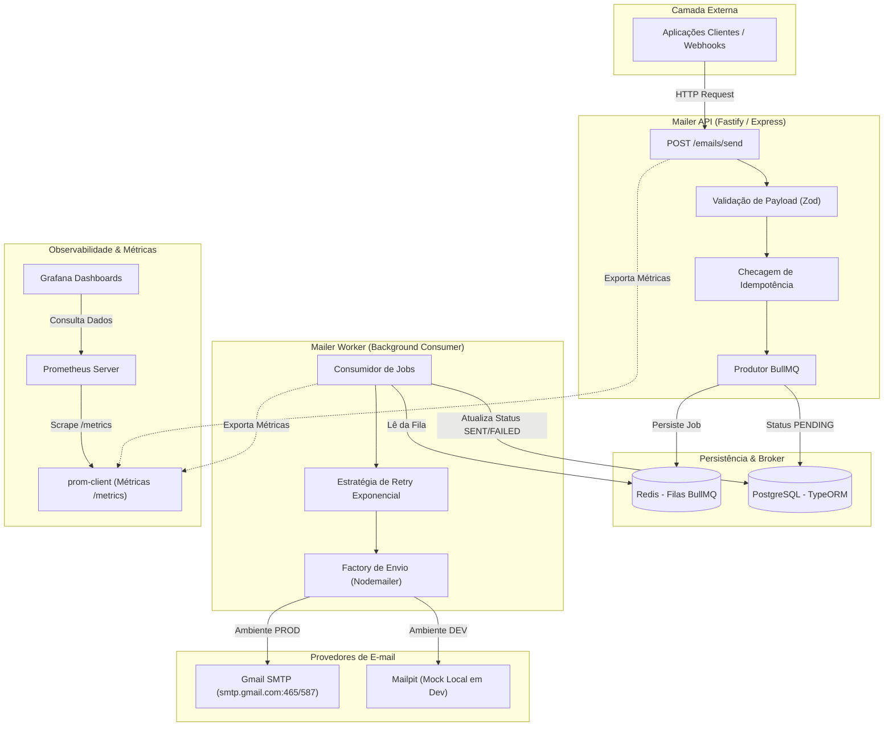

# 🚀 Mailer Service — Documento Base de Arquitetura & Referência

Documento oficial de referência técnica para o desenvolvimento do serviço de mensageria e disparo de e-mails assíncrono com padrão **Full Cycle** (da concepção à observabilidade e deploy).

---

## 1. Visão Geral do Projeto

O **Mailer Service** é um microsserviço assíncrono projetado para:
- Receber solicitações de envio de e-mails via API HTTP resiliente.
- Enfileirar mensagens para processamento desacoplado via **BullMQ + Redis**.
- Processar envios em background com **Nodemailer**, suportando **Gmail SMTP (App Password)** em produção/staging e **Mailpit** para testes locais.
- Persistir histórico completo, auditoria e status de cada disparo usando **TypeORM** com **PostgreSQL**.
- Expor métricas detalhadas em tempo real via **Prometheus** e visualização no **Grafana**.
- Automatizar testes, build de imagens Docker e pipelines via **GitHub Actions** (CI/CD).

---

## 2. Diagrama de Arquitetura



---

## 3. Stack Tecnológica

| Camada | Ferramenta | Finalidade |
| :--- | :--- | :--- |
| **Linguagem & Runtime** | Node.js (v20+ LTS) + TypeScript | Tipagem estática rigorosa e alta performance de E/S assíncrona. |
| **Framework HTTP** | Fastify (ou Express) | API rápida para enfileiramento imediato com baixo overhead de memória. |
| **ORM & Banco Relacional** | **TypeORM** + **PostgreSQL** | Mapeamento objeto-relacional com migrations, entidades bem definidas e pooling de conexões. |
| **Fila Assíncrona** | **BullMQ** + **Redis** | Gerenciamento de tarefas em segundo plano, retentativas automáticas, backoff exponencial e Dead-Letter Queue (DLQ). |
| **Envio de E-mail** | **Nodemailer** | Suporte unificado a transporte SMTP (Google Workspace/Gmail e Mailpit). |
| **Observabilidade** | `prom-client` + **Prometheus** + **Grafana** | Monitoramento de taxa de envio, latência, erros e saúde das filas. |
| **DevOps & Containers** | **Docker** + **Docker Compose** | Empacotamento de toda a infraestrutura local em um único comando. |
| **CI/CD** | **GitHub Actions** | Automação de testes unitários/integração, lint, typecheck e build de imagem Docker. |

---

## 4. Modelagem de Dados (TypeORM)

### 4.1. Entidade: `EmailJob` (`emails`)

Armazena o ciclo de vida completo de cada envio solicitado.

```typescript
// src/database/entities/EmailJob.ts
import {
  Entity,
  PrimaryGeneratedColumn,
  Column,
  CreateDateColumn,
  UpdateDateColumn,
  Index
} from 'typeorm';

export enum EmailStatus {
  PENDING = 'PENDING',
  PROCESSING = 'PROCESSING',
  SENT = 'SENT',
  FAILED = 'FAILED',
  CANCELLED = 'CANCELLED'
}

@Entity('emails')
export class EmailJob {
  @PrimaryGeneratedColumn('uuid')
  id: string;

  @Index({ unique: true })
  @Column({ type: 'varchar', length: 120, nullable: true })
  idempotencyKey?: string;

  @Column({ type: 'varchar', length: 255 })
  to: string;

  @Column({ type: 'varchar', length: 255, nullable: true })
  from: string;

  @Column({ type: 'varchar', length: 255 })
  subject: string;

  @Column({ type: 'text' })
  body: string;

  @Column({ type: 'enum', enum: EmailStatus, default: EmailStatus.PENDING })
  status: EmailStatus;

  @Column({ type: 'int', default: 0 })
  attempts: number;

  @Column({ type: 'int', default: 3 })
  maxAttempts: number;

  @Column({ type: 'text', nullable: true })
  lastError?: string;

  @Column({ type: 'varchar', length: 100, nullable: true })
  externalMessageId?: string; // ID gerado pelo SMTP do Gmail

  @Column({ type: 'jsonb', nullable: true })
  metadata?: Record<string, any>;

  @CreateDateColumn()
  createdAt: Date;

  @UpdateDateColumn()
  updatedAt: Date;

  @Column({ type: 'timestamp', nullable: true })
  sentAt?: Date;
}
```

---

## 5. Configuração do Transporter (Gmail & Mailpit)

> [!IMPORTANT]
> **Atenção sobre o Gmail SMTP**:
> - O Gmail possui limites de envio (contas gratuitas `@gmail.com` têm limite de até **500 e-mails por 24 horas**).
> - Nunca utilize a senha padrão da sua conta. Utilize sempre a **Senha de Aplicativo (App Password)** gerada no painel de segurança da sua Conta Google com 2FA ativado.
> - Suas credenciais devem ficar restritas ao `.env` (nunca commitadas no repositório).

### Factory do Transporter

```typescript
// src/config/mail.ts
import nodemailer from 'nodemailer';

export const createMailTransporter = () => {
  const isDev = process.env.NODE_ENV !== 'production';

  // Em desenvolvimento local podemos usar Mailpit ou Gmail
  if (process.env.MAIL_PROVIDER === 'gmail') {
    return nodemailer.createTransport({
      service: 'gmail',
      auth: {
        user: process.env.GOOGLE_ACCOUNT_USER, // contatochecker@gmail.com
        pass: process.env.GOOGLE_ACCOUNT_PASSWORD // App Password (sem espaços)
      }
    });
  }

  // Fallback para Mailpit local (Docker)
  return nodemailer.createTransport({
    host: process.env.SMTP_HOST || 'localhost',
    port: Number(process.env.SMTP_PORT) || 1025,
    secure: false
  });
};
```

---

## 6. Estrutura Recomendada do Repositório

```text
mailer-fullcycle/
├── .github/
│   └── workflows/
│       ├── ci.yml                 # Testes, linting e build
│       └── cd.yml                 # Build de container e deploy
├── docker/
│   ├── prometheus/
│   │   └── prometheus.yml         # Configuração de scraping
│   └── grafana/
│       └── provisioning/
│           ├── datasources/       # Conexão automática ao Prometheus
│           └── dashboards/        # Dashboards prontos de monitoramento
├── src/
│   ├── config/                    # Variáveis de ambiente e clients (TypeORM, Redis, Nodemailer)
│   ├── database/
│   │   ├── entities/              # Entidades TypeORM (EmailJob)
│   │   ├── migrations/            # Migrações gerenciadas pelo TypeORM
│   │   └── data-source.ts         # Configuração centralizada do DataSource
│   ├── modules/
│   │   └── mailer/
│   │       ├── dtos/              # Schemas de validação de entrada (ex: Zod)
│   │       ├── services/          # Regras de negócio (enfileiramento, disparo)
│   │       ├── queues/            # Definição das filas BullMQ
│   │       └── workers/           # Consumidores BullMQ que disparam os e-mails
│   ├── shared/
│   │   ├── errors/                # Classes de exceção personalizadas
│   │   └── metrics/               # Registros e contadores do Prometheus (prom-client)
│   ├── app.ts                     # Setup do servidor HTTP
│   └── server.ts                  # Ponto de entrada (API + Workers)
├── .env.example                   # Modelo de variáveis
├── docker-compose.yml             # Postgres, Redis, Mailpit, Prometheus, Grafana
├── Dockerfile                     # Multi-stage build otimizado para produção
├── package.json
└── tsconfig.json
```

---

## 7. Observabilidade com Grafana & Prometheus

### Métricas Principais a Coletar (`prom-client`):
1. **`mailer_emails_total` (Counter)**: Total de solicitações de e-mail agrupadas por status (`queued`, `sent`, `failed`).
2. **`mailer_send_duration_seconds` (Histogram)**: Tempo em segundos gasto para o transporte SMTP responder o envio.
3. **`mailer_queue_jobs_count` (Gauge)**: Quantidade instantânea de itens na fila BullMQ (`waiting`, `active`, `failed`, `delayed`).
4. **`http_request_duration_seconds` (Histogram)**: Latência da API HTTP ao receber pedidos.

### Arquitetura de Provisionamento:
Ao rodar `docker compose up`, o Grafana sobe já conectado ao Prometheus com um dashboard pré-configurado contendo gráficos de vazão, taxa de erro de entrega e alertas.

---

## 8. Variáveis de Ambiente (`.env.example`)

```env
# Ambiente
NODE_ENV=development
PORT=3333

# Banco de Dados (TypeORM / PostgreSQL)
DB_HOST=localhost
DB_PORT=5432
DB_USER=mailer_user
DB_PASSWORD=mailer_password
DB_NAME=mailer_db

# Fila (Redis)
REDIS_HOST=localhost
REDIS_PORT=6379

# Provedor de E-mail ('gmail' ou 'mailpit')
MAIL_PROVIDER=gmail

# Credenciais Google / Gmail
GOOGLE_ACCOUNT_USER="contatochecker@gmail.com"
GOOGLE_ACCOUNT_PASSWORD="whodjedjdpvkswts" # App Password (recomenda-se sem espaços)
EMAIL_FROM_DEFAULT="contatochecker@gmail.com"

# Mailpit (Dev Local)
SMTP_HOST=localhost
SMTP_PORT=1025
```

---

## 9. Próximos Passos de Execução

1. **Passo 1**: Inicializar o repositório (`package.json`, `tsconfig.json` e dependências core: TypeORM, pg, BullMQ, ioredis, nodemailer, prom-client).
2. **Passo 2**: Montar o `docker-compose.yml` base com PostgreSQL, Redis e Mailpit.
3. **Passo 3**: Criar a configuração do TypeORM (`data-source.ts`) e a entidade `EmailJob`.
4. **Passo 4**: Implementar o Worker de envio conectado à conta Google via Nodemailer.
5. **Passo 5**: Adicionar a rota de métricas e os containers do Prometheus + Grafana.

