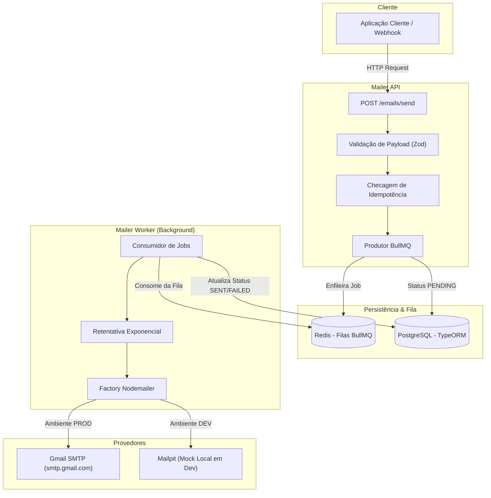

# 📬 Mailer Service — Full Cycle

Serviço assíncrono de alto desempenho para processamento e disparo de e-mails em escala, construído com foco em **resiliência, desacoplamento, observabilidade e padrão Full Cycle**.


---

## 📖 Sobre o Projeto

Em sistemas de produção, o disparo de e-mails nunca deve bloquear a requisição HTTP do usuário. Provedores SMTP podem oscilar, sofrer com lentidão de rede ou limites de taxa (*rate limits*).

Este serviço resolve esse desafio aplicando **arquitetura orientada a eventos e filas assíncronas**:
1. A API HTTP recebe a solicitação de envio, valida a entrada, garante **idempotência** e enfileira a mensagem no **Redis**.
2. A API responde imediatamente com status HTTP `202 Accepted`, liberando o cliente em milissegundos.
3. Um **Worker BullMQ** em segundo plano processa os itens da fila, atualiza o status de entrega no **PostgreSQL** e dispara o e-mail via **Nodemailer** (com suporte a **Gmail SMTP** e servidor mock local **Mailpit**).
4. Em caso de oscilações ou falhas no provedor SMTP, o sistema executa **retentativas automáticas com Backoff Exponencial**.

---

## 📐 Arquitetura



---

## 🛠️ Tecnologias Utilizadas

- **Linguagem & Runtime:** Node.js (v20+ LTS) e TypeScript
- **ORM & Banco de Dados:** TypeORM com PostgreSQL 16
- **Fila & Processamento Assíncrono:** BullMQ com Redis 7
- **Cliente SMTP:** Nodemailer (Gmail App Password & Mailpit)
- **Framework HTTP:** Fastify (com validação Zod)
- **Containerização:** Docker & Docker Compose
- **Observabilidade:** Prometheus & Grafana *(em evolução)*
- **CI/CD:** GitHub Actions *(em evolução)*

---

## 🚀 Como Executar Localmente

### Pré-requisitos
- [Node.js](https://nodejs.org/) (versão 20 ou superior)
- [Docker](https://www.docker.com/) e Docker Compose instalados

### 1. Clonar o repositório
```bash
git clone https://github.com/thiagoeu/mailer-fullcyle.git
cd mailer-fullcyle
```

### 2. Instalar dependências
```bash
npm install
```

### 3. Configurar variáveis de ambiente
Copie o arquivo de exemplo:
```bash
cp .env.example .env
```
Ajuste as configurações no `.env` conforme necessário.

### 4. Subir a infraestrutura (PostgreSQL, Redis, Mailpit, Prometheus e Grafana)
```bash
docker compose up -d
```
- **PostgreSQL:** `localhost:5432`
- **Redis:** `localhost:6379`
- **Mailpit (Web UI):** [http://localhost:8025](http://localhost:8025)
- **Prometheus:** [http://localhost:9090](http://localhost:9090)
- **Grafana (Dashboards):** [http://localhost:3000](http://localhost:3000) (admin / admin)

### 5. Iniciar a API e Worker
```bash
npm run dev
```
- **API HTTP:** `http://localhost:3333`
- **Documentacao Swagger UI:** [http://localhost:3333/docs](http://localhost:3333/docs)
- **Healthcheck:** [http://localhost:3333/health](http://localhost:3333/health)
- **Metricas Prometheus:** [http://localhost:3333/metrics](http://localhost:3333/metrics)

### 6. Testes rapidos dos componentes
```bash
# 1. Testar conexão com o banco e criação das tabelas
npx tsx src/scripts/test-db.ts

# 2. Testar autenticação e envio SMTP
npx tsx src/scripts/test-mail.ts

# 3. Testar o fluxo completo assíncrono (Fila + Worker + Banco)
npx tsx src/scripts/test-queue.ts
```

---

## 📂 Estrutura do Projeto

```text
mailer-fullcycle/
├── dev/                           # Roadmap e planejamento local (não versionado)
│   └── roadmap.md
├── src/
│   ├── config/                    # Configurações de conexão (TypeORM, Redis, Nodemailer)
│   │   ├── mail.ts
│   │   └── redis.ts
│   ├── database/                  # Banco de dados e ORM
│   │   ├── entities/              # Entidades TypeORM (EmailJob)
│   │   └── data-source.ts         # DataSource do TypeORM
│   ├── modules/
│   │   └── mailer/
│   │       ├── queues/            # Definição das filas BullMQ
│   │       └── workers/           # Consumidores em background
│   └── scripts/                   # Scripts utilitários de validação e testes
├── .env.example                   # Template de variáveis de ambiente
├── .gitignore                     # Proteção de credenciais e dependências
├── ARCHITECTURE.md                # Documento completo de arquitetura
├── docker-compose.yml             # Containers de Postgres, Redis e Mailpit
├── package.json
└── tsconfig.json
```

---

## 📄 Licença

Este projeto é desenvolvido sob a licença [MIT](LICENSE).
