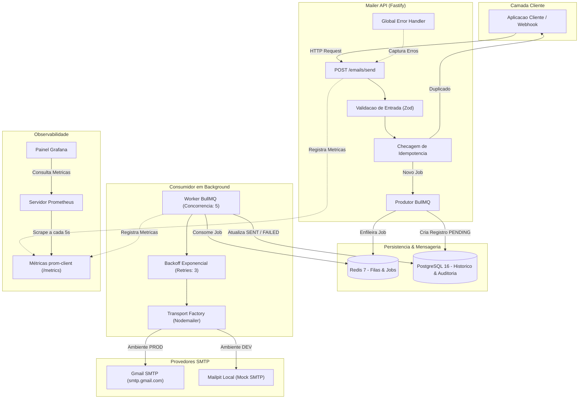

# Mailer Service — Full Cycle

Servico assincrono de alto desempenho para processamento e disparo de e-mails em escala corporativa. Desenvolvido com foco em **resiliencia, tolerancia a falhas, idempotencia, observabilidade em tempo real e Clean Architecture**.


---

## Indice

- [Visao Geral](#visao-geral)
- [Principais Funcionalidades](#principais-funcionalidades)
- [Arquitetura do Sistema](#arquitetura-do-sistema)
- [Stack Tecnologica](#stack-tecnologica)
- [Estrutura do Projeto](#estrutura-do-projeto)
- [Design de Software e Boas Praticas](#design-de-software-e-boas-praticas)
- [Infraestrutura e Dependencias](#infraestrutura-e-dependencias)
- [Guia de Instalacao e Execucao](#guia-de-instalacao-e-execucao)
- [Documentacao da API (OpenAPI / Swagger)](#documentacao-da-api-openapi--swagger)
- [Observabilidade e Metricas](#observabilidade-e-metricas)
- [Scripts de Verificacao Automatizada](#scripts-de-verificacao-automatizada)
- [Licenca](#licenca)

---

## Visao Geral

Em aplicacoes de producao, o envio direto de e-mails em endpoints sincronos representa um ponto critico de lentidao e falha. Servidores SMTP externos (como Gmail, AWS SES ou SendGrid) estao sujeitos a latencias de rede, oscilacoes e politicas restritivas de taxa (*rate limits*).

O **Mailer Service** resolve esses problemas atraves de uma arquitetura orientada a eventos e filas assincronas:
1. **Desacoplamento Imediato:** O endpoint HTTP recebe a requisicao, valida os dados e enfileira o job em milissegundos, respondendo com status `202 Accepted`.
2. **Consumo em Background:** Workers BullMQ consom a fila de forma assincrona e concorrente, disparando os e-mails via Nodemailer.
3. **Resiliencia Automatica:** Erros transitorios disparam retentativas automaticas com backoff exponencial. Se o provedor falhar, nenhum e-mail e perdido.
4. **Garantia de Idempotencia:** Requisicoes duplicadas nao geram disparos repetidos.
5. **Observabilidade Completa:** Metricas de execucao, volumetria, duracao e fila sao exportadas para o Prometheus e exibidas em dashboards do Grafana.

---

## Principais Funcionalidades

- **API REST de Alta Performance:** Construida em Fastify v5 com tipagem nativa Zod via `@fastify/type-provider-zod`.
- **Garantia de Idempotencia:** Suporte a header `x-idempotency-key` com deduplicacao baseada em banco de dados (`UNIQUE INDEX`).
- **Filas com BullMQ + Redis:** Controle de concorrencia, politicas de retentativa (3 tentativas com atraso exponencial) e Dead-Letter Queue (DLQ).
- **Provedores SMTP Hibridos:**
  - **Desenvolvimento:** Servidor mock local **Mailpit** (captura e inspecao visual de e-mails sem risco de disparo externo).
  - **Producao:** **Gmail SMTP** com autenticacao via App Password ou qualquer provedor padrao SMTP.
- **Auditoria e Persistencia com TypeORM:** Historico completo de cada transacao de e-mail (status, tentativas, mensagens de erro, external message IDs e metadados JSONB).
- **Tratamento Global de Erros:** Captura centralizada de falhas via `globalErrorHandler` com respostas JSON estruturadas, seguras e aderentes a RFCs.
- **Metricas Prometheus:** Exportacao em tempo real de latencia HTTP, status dos disparos e tamanho das filas.
- **Painel Grafana Provisionado:** Dashboard `mailer-dashboard.json` pre-configurado como codigo (IaC) e conectado automaticamente ao Prometheus.
- **Documentacao Interativa:** Swagger UI disponivel em `/docs`.

---

## Arquitetura do Sistema



---

## Stack Tecnologica

| Componente | Tecnologia | Versao | Finalidade |
| :--- | :--- | :--- | :--- |
| **Runtime** | Node.js | >= 20.x | Ambiente de execucao assincrono de alto desempenho |
| **Linguagem** | TypeScript | 5.x | Tipagem estatica estrita e previsibilidade de codigo |
| **Framework HTTP** | Fastify | 5.x | Servidor HTTP de baixo consumo e baixa latencia |
| **Validacao** | Zod | 3.24.x | Schemas declarativos, validacao em tempo de execucao e inferencia de tipos |
| **Integracao Zod/Fastify** | fastify-type-provider-zod | 4.0.2 | Tipagem de rotas e geracao automatica de schemas OpenAPI |
| **ORM** | TypeORM | 0.3.x | Mapeamento relacional com suporte a migrations e pooling |
| **Banco de Dados** | PostgreSQL | 16 | Armazenamento relacional com suporte a JSONB e chaves unicas |
| **Broker de Fila** | BullMQ | 5.x | Gerenciamento de tarefas em segundo plano com suporte a retry |
| **Armazenamento em Memoria** | Redis | 7 | Persistencia rapida de filas, travas e estados de jobs |
| **Disparo de E-mails** | Nodemailer | 6.x | Cliente SMTP flexivel e compativel com multiplos provedores |
| **Documentacao** | Swagger UI | 5.x | Interface interativa OpenAPI para documentacao e teste da API |
| **Coleta de Metricas** | prom-client | 15.x | Instrumentacao nativa de contadores, histogramas e gauges |
| **Monitoramento** | Prometheus & Grafana | 2.51 / 10.4 | Coleta e visualizacao em tempo real de metricas do sistema |
| **Conteinerizacao** | Docker & Compose | v2 | Orquestracao de servicos de infraestrutura em ambiente isolado |

---

## Estrutura do Projeto

O projeto segue padroes de **Clean Architecture**, mantendo desacoplamento claro entre rotas, validacao, logica de negocios e acesso a dados:

```text
mailer-fullcycle/
├── docker/
│   ├── grafana/
│   │   ├── dashboards/
│   │   │   └── mailer-dashboard.json       # Dashboard analitico exportado como codigo
│   │   └── provisioning/
│   │       ├── dashboards/                 # Auto-provisionamento de dashboards
│   │       └── datasources/                # Auto-conexao com a fonte Prometheus
│   └── prometheus/
│       └── prometheus.yml                  # Regras de scrape (intervalo de 5s)
├── src/
│   ├── config/
│   │   ├── mail.ts                         # Fabrica do transporte SMTP (Gmail ou Mailpit)
│   │   ├── redis.ts                        # Parametros de conexao do cliente Redis
│   │   └── swagger.ts                      # Configuracao OpenAPI / Swagger UI
│   ├── database/
│   │   ├── entities/
│   │   │   └── EmailJob.ts                 # Entidade TypeORM (auditoria e ciclo de vida)
│   │   └── data-source.ts                  # Configuracao e inicializacao do TypeORM
│   ├── modules/
│   │   └── mailer/
│   │       ├── controllers/
│   │       │   └── email.controller.ts      # Thin Controller (orquestracao HTTP pura)
│   │       ├── dtos/
│   │       │   └── send-email.dto.ts       # Schemas Zod de entrada e tipos inferidos
│   │       ├── interfaces/
│   │       │   ├── enqueue-email-result.interface.ts # Contratos de retorno do servico
│   │       │   └── send-email-job-data.interface.ts  # Payload persistido na fila
│   │       ├── queues/
│   │       │   └── email.queue.ts          # Definicao da fila BullMQ e politicas de retry
│   │       ├── routes/
│   │       │   └── email.routes.ts         # Rotas HTTP limpas e concisas
│   │       ├── schemas/
│   │       │   └── email.schema.ts         # Metadados OpenAPI/Swagger desacoplados
│   │       ├── services/
│   │       │   └── email.service.ts        # Regras de negocio, idempotencia e auditoria
│   │       └── workers/
│   │           └── email.worker.ts         # Consumidor em background e integracao SMTP
│   ├── shared/
│   │   ├── constants/
│   │   │   ├── messages.constants.ts       # Textos padronizados de resposta
│   │   │   ├── queue.constants.ts          # Nomes de filas e parametros de retry
│   │   │   └── swagger.constants.ts        # Titulos, descricoes e tags da documentacao
│   │   ├── enums/
│   │   │   ├── email-status.enum.ts        # PENDING, PROCESSING, SENT, FAILED
│   │   │   ├── http-status.enum.ts         # Status codes padronizados (200, 202, 400, etc.)
│   │   │   └── mail-provider.enum.ts       # GMAIL, MAILPIT, SES, RESEND
│   │   ├── errors/
│   │   │   ├── app-error.ts                # Classe base com statusCode e flag operacional
│   │   │   ├── bad-request-error.ts        # Erro 400
│   │   │   ├── conflict-error.ts           # Erro 409
│   │   │   ├── not-found-error.ts          # Erro 404
│   │   │   └── global-error-handler.ts     # Middleware global de tratamento e formatacao
│   │   └── metrics/
│   │       └── index.ts                    # Instrumentacao prom-client (Counters, Histograms)
│   ├── scripts/
│   │   ├── test-api.ts                     # Teste ponta a ponta da API HTTP
│   │   ├── test-db.ts                      # Validacao de conectividade e DDL do PostgreSQL
│   │   ├── test-mail.ts                    # Validacao de credenciais SMTP reais
│   │   ├── test-metrics.ts                 # Validacao de exposicao de metricas
│   │   └── test-queue.ts                   # Validacao completa do fluxo assincrono
│   ├── app.ts                              # Montagem da aplicacao Fastify e plugins
│   └── server.ts                           # Ponto de entrada com encerramento gracioso
├── .env.example                            # Modelo seguro de configuracao de ambiente
├── .gitignore                              # Politica estrita de seguranca e arquivos locais
├── ARCHITECTURE.md                         # Documento detalhado de especificacao arquitetural
├── docker-compose.yml                      # Orquestracao dos 5 containers de infraestrutura
├── package.json                            # Dependencias do projeto e scripts de execucao
└── tsconfig.json                           # Configuracao rigorosa do compilador TypeScript
```

---

## Design de Software e Boas Praticas

### 1. Thin Controllers & Camada de Servico
Os controllers HTTP sao intencionalmente magros (*Thin Controllers*). A responsabilidade do controller restringe-se a receber a requisicao, extrair os dados validados, delegar a operacao ao `EmailService` e responder com o codigo HTTP apropriado.

### 2. Idempotencia com Protecao em Nivel de Banco
Para evitar duplicidade de envios em caso de retransmissoes de rede ou chamadas repetidas pelo cliente:
- A entidade `EmailJob` define uma coluna `idempotencyKey` com `UNIQUE INDEX`.
- Antes de enfileirar qualquer job, o `EmailService` consulta o banco. Se a chave ja existir, retorna imediatamente o registro existente com status HTTP `200 OK`, sem produzir uma nova mensagem na fila.

### 3. Tratamento Centralizado de Erros (Global Error Handler)
O tratamento de excecoes nao e espalhado com blocos `try/catch` redundantes nos controllers. Todas as falhas sobem para o `globalErrorHandler` configurado no Fastify:
- **Erros de Validacao Zod:** Formatados em uma lista amigavel `errors: [{ field, message }]` com status HTTP `400`.
- **Erros Operacionais (`AppError`):** Retornam a mensagem de negocio esperada e o status HTTP correto.
- **Erros Inesperados:** Registrados nos logs do servidor e respondidos com mensagem generica `Internal Server Error` (status `500`), sem vazar detalhes internos da infraestrutura.

### 4. Encerramento Gracioso (Graceful Shutdown)
O `src/server.ts` intercepta os sinais do sistema operacional (`SIGINT` e `SIGTERM`):
- Fecha o servidor HTTP para novas conexoes.
- Aguarda a conclusao dos jobs em processamento no BullMQ Worker.
- Encerra de forma segura as conexoes do TypeORM e do Redis.

---

## Infraestrutura e Dependencias

O ambiente e provisionado localmente via Docker Compose, composto por 5 servicos:

| Servico | Imagem | Porta Externa | Finalidade |
| :--- | :--- | :--- | :--- |
| **PostgreSQL** | `postgres:16-alpine` | `5432` | Banco de dados relacional principal |
| **Redis** | `redis:7-alpine` | `6379` | Broker de mensageria para o BullMQ |
| **Mailpit (SMTP)** | `axllent/mailpit:latest` | `1025` | Servidor SMTP local para testes sem envio externo |
| **Mailpit (Web UI)**| `axllent/mailpit:latest` | `8025` | Interface web para inspecionar os e-mails capturados |
| **Prometheus** | `prom/prometheus:v2.51.0`| `9090` | Servidor de monitoramento e raspagem de metricas |
| **Grafana** | `grafana/grafana:10.4.0` | `3000` | Painel visual provisionado com dashboards pre-configurados |

---

## Guia de Instalacao e Execucao

### 1. Pre-requisitos
- **Node.js** v20 ou superior
- **Docker** e **Docker Compose** instalados e em execucao

### 2. Clonar o Repositorio e Instalar Dependencias
```bash
git clone https://github.com/thiagoeu/mailer-fullcyle.git
cd mailer-fullcycle
npm install
```

### 3. Configurar as Variaveis de Ambiente
Crie um arquivo `.env` a partir do template seguro:
```bash
cp .env.example .env
```

Ajuste as variaveis conforme o seu ambiente:
```env
# Servidor
PORT=3333
NODE_ENV=development

# Banco de Dados (PostgreSQL)
DB_HOST=localhost
DB_PORT=5432
DB_USER=mailer_user
DB_PASS=mailer_pass
DB_NAME=mailer_db

# Fila e Cache (Redis)
REDIS_HOST=localhost
REDIS_PORT=6379

# Provedor de E-mail: "gmail" ou "mailpit"
MAIL_PROVIDER=mailpit

# Configuracao Gmail (necessario apenas se MAIL_PROVIDER=gmail)
GMAIL_USER=seu-email@gmail.com
GMAIL_APP_PASSWORD=sua-senha-de-app-16-digitos

# Configuracao Mailpit Local
MAILPIT_HOST=localhost
MAILPIT_PORT=1025

# Remetente Padrao
MAIL_FROM="Mailer Service <noreply@mailer.local>"
```

### 4. Subir a Infraestrutura com Docker
```bash
docker compose up -d
```

Verifique o status dos containers:
```bash
docker compose ps
```

### 5. Iniciar o Servidor e o Worker
```bash
npm run dev
```

A aplicacao estara disponivel em:
- **API Base:** `http://localhost:3333`
- **Documentacao Swagger UI:** [http://localhost:3333/docs](http://localhost:3333/docs)
- **Healthcheck:** [http://localhost:3333/health](http://localhost:3333/health)
- **Metricas Prometheus:** [http://localhost:3333/metrics](http://localhost:3333/metrics)
- **Mailpit Web UI:** [http://localhost:8025](http://localhost:8025)
- **Painel Grafana:** [http://localhost:3000](http://localhost:3000) (Login: `admin` | Senha: `admin`)

---

## Documentacao da API (OpenAPI / Swagger)

A documentacao interativa e gerada automaticamente a partir dos schemas Zod e esta disponivel em:
> **URL:** [http://localhost:3333/docs](http://localhost:3333/docs)

### Endpoints Principais

#### 1. Enfileirar Disparo de E-mail
- **Metodo:** `POST`
- **Rota:** `/emails/send`
- **Headers Opcionais:**
  - `x-idempotency-key: string` (UUID ou identificador unico da solicitacao)
- **Body:**
```json
{
  "to": "destinatario@exemplo.com",
  "subject": "Boas-vindas ao servico",
  "body": "Ola, sua solicitacao foi processada com sucesso.",
  "html": "<p>Ola, sua solicitacao foi processada com sucesso.</p>",
  "metadata": {
    "userId": "123e4567-e89b-12d3-a456-426614174000",
    "origin": "billing_webhook"
  }
}
```
- **Respostas:**
  - `202 Accepted`: Job recebido e inserido na fila de processamento.
  - `200 OK`: Requisicao idempotente (retorna o job ja existente sem duplicar).
  - `400 Bad Request`: Payload invalido ou campos obrigatorios ausentes.

#### 2. Consultar Status do Envio
- **Metodo:** `GET`
- **Rota:** `/emails/:id`
- **Parametro de URL:** `id` (UUID gerado no momento do enfileiramento)
- **Respostas:**
  - `200 OK`: Dados completos do envio (status `PENDING`, `PROCESSING`, `SENT` ou `FAILED`, total de tentativas e datas).
  - `404 Not Found`: E-mail nao localizado na base de dados.

#### 3. Healthcheck da Aplicacao
- **Metodo:** `GET`
- **Rota:** `/health`
- **Resposta:**
```json
{
  "status": "ok",
  "timestamp": "2026-11-12T12:00:00.000Z",
  "uptime": 120.45
}
```

---

## Observabilidade e Metricas

O servico foi projetado com observabilidade nativa:

### Metricas Coletadas (`prom-client`)
- `mailer_emails_total`: Contador total de e-mails processados (labels: `provider`, `status`).
- `mailer_send_duration_seconds`: Histograma do tempo gasto no disparo SMTP.
- `mailer_queue_jobs_count`: Gauge com a quantidade atual de jobs em cada estado da fila BullMQ (`waiting`, `active`, `completed`, `failed`, `delayed`).
- `http_request_duration_seconds`: Histograma de latencia das requisicoes HTTP (labels: `method`, `route`, `status_code`).

### Painel Grafana
O Grafana ja vem com o datasource Prometheus provisionado e o dashboard **Mailer Service Overview** configurado automaticamente:
1. Acesse [http://localhost:3000](http://localhost:3000).
2. Faca login com `admin` / `admin`.
3. Navegue ate **Dashboards > Mailer Service Overview**.
4. Visualize taxas de envio por segundo, latencia SMTP, taxa de erros e volumetria da fila.

---

## Scripts de Verificacao Automatizada

O projeto conta com scripts isolados para validar cada componente da stack de forma independente:

```bash
# 1. Validar conexao com o PostgreSQL e criacao de tabelas (DDL)
npx tsx src/scripts/test-db.ts

# 2. Validar autenticacao e envio SMTP direto via Nodemailer
npx tsx src/scripts/test-mail.ts

# 3. Validar fluxo completo assincrono (BullMQ Producer -> Worker -> SMTP -> PostgreSQL)
npx tsx src/scripts/test-queue.ts

# 4. Validar API HTTP (Healthcheck, Validacoes Zod, Status 202, Idempotencia 200 e GET por ID)
npx tsx src/scripts/test-api.ts

# 5. Validar geracao e raspagem das metricas Prometheus
npx tsx src/scripts/test-metrics.ts
```

---

## Licenca

Este projeto e distribuido sob os termos da licenca [MIT](LICENSE).
