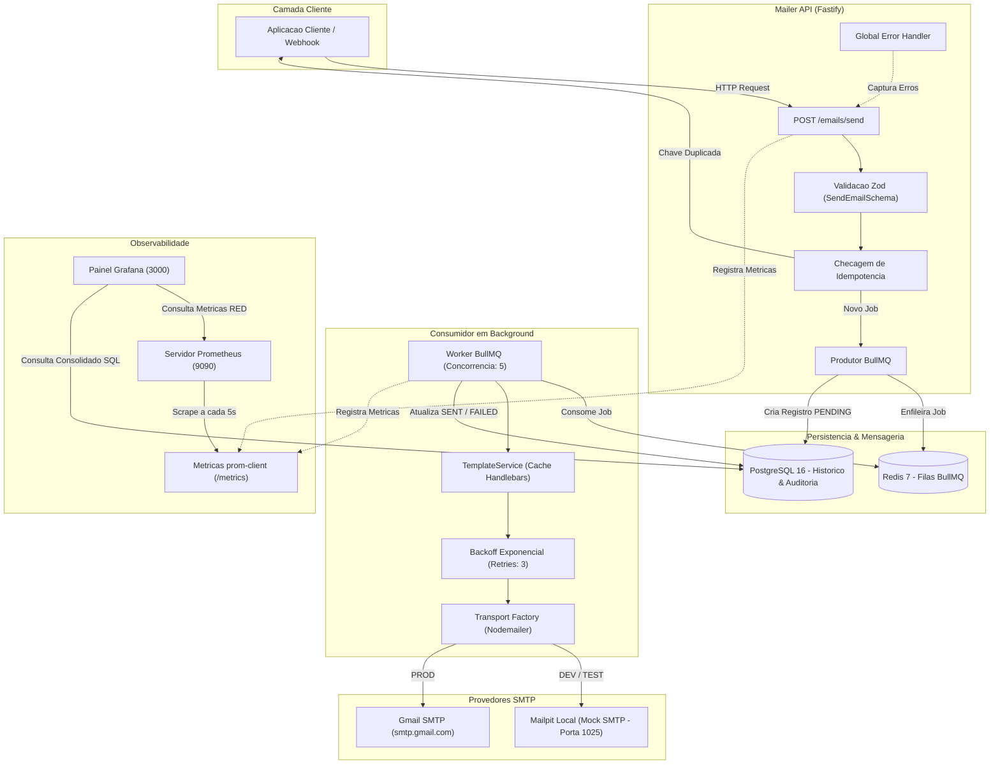

# Mailer Service — Full Cycle

Servico assincrono de alto desempenho para processamento e disparo de e-mails em escala corporativa. Desenvolvido com foco em **resiliencia, tolerancia a falhas, idempotencia, observabilidade em tempo real, templates dinamicos, testes automatizados e Clean Architecture**.


---

## Indice

- [Visao Geral](#visao-geral)
- [Principais Funcionalidades](#principais-funcionalidades)
- [Arquitetura do Sistema](#arquitetura-do-sistema)
- [Stack Tecnologica](#stack-tecnologica)
- [Estrutura do Projeto](#estrutura-do-projeto)
- [Design de Software e Boas Praticas](#design-de-software-e-boas-praticas)
- [Templates Dinamicos com Cache](#templates-dinamicos-com-cache)
- [Estrategia de Testes Automatizados](#estrategia-de-testes-automatizados)
- [Pipelines de CI/CD e Conteinerizacao](#pipelines-de-cicd-e-conteinerizacao)
- [Infraestrutura e Dependencias](#infraestrutura-e-dependencias)
- [Guia de Instalacao e Execucao](#guia-de-instalacao-e-execucao)
- [Documentacao da API (OpenAPI / Swagger)](#documentacao-da-api-openapi--swagger)
- [Observabilidade e Metricas](#observabilidade-e-metricas)
- [Scripts de Verificacao Manual](#scripts-de-verificacao-manual)
- [Licenca](#licenca)

---

## Visao Geral

Em aplicacoes corporativas, o disparo sincrono de e-mails e um anti-padrao grave que causa travamentos de requisicao, lentidao perceptual para o usuario e falhas criticas quando servidores SMTP externos (Gmail, AWS SES, Resend) sofrem instabilidades ou aplicam limites de taxa (*rate limits*).

O **Mailer Service** resolve esses problemas atraves de uma arquitetura orientada a eventos e filas assincronas:
1. **Desacoplamento Imediato:** O endpoint HTTP recebe a solicitacao, valida os contratos via Zod e enfileira a mensagem no Redis em milissegundos, respondendo `202 Accepted`.
2. **Processamento em Background:** Workers dedicados consom a fila do BullMQ de forma concorrente e resiliente.
3. **Tolerancia a Falhas:** Erros transitorios de envio disparam retentativas automaticas com backoff exponencial.
4. **Garantia de Idempotencia:** Chaves unicas de transacao impedem envios duplicados, mesmo sob retransmissoes acidentais de rede.
5. **Templates Compilados:** Motor Handlebars com cache em memoria RAM para renderizacao de layouts HTML seguros e de alto desempenho.
6. **Observabilidade Nativa:** Metricas operacionais expostas para Prometheus e visualizadas em painel customizado no Grafana.
7. **Engenharia de Testes e CI/CD:** Suite de testes com Vitest (unitarios e integracao in-memory) e automacao de validacao a cada commit.

---

## Principais Funcionalidades

- **API REST de Baixa Latencia:** Construida com Fastify v5 e tipagem estrita via `fastify-type-provider-zod`.
- **Idempotencia com Protecao em Banco:** Deduplicacao física via `UNIQUE INDEX` na entidade `EmailJob` do PostgreSQL.
- **Filas Robustas com BullMQ e Redis:** Controle de concorrencia, tentativas configuradas e remocao inteligente de jobs antigos em memoria.
- **Templates Dinamicos com Handlebars (`.hbs`):** Isolamento de design visual com escape automatico contra ataques XSS e compilacao cacheada em memoria.
- **Provedores SMTP Hibridos:**
  - **Ambiente de Testes / Desenvolvimento:** Servidor mock **Mailpit** (captura e inspecao de e-mails em interface web local sem risco de disparo externo).
  - **Ambiente de Producao:** **Gmail SMTP** com autenticacao via App Password ou provedor corporativo.
- **Tratamento Centralizado de Erros:** Middleware `globalErrorHandler` com respostas JSON no padrao RFC, sem vazamento de detalhes internos.
- **Suite de Testes com Vitest:** 22 testes automatizados (unitarios e integracao HTTP in-memory com `app.inject()`), rodando em menos de 1 segundo.
- **Docker Multi-Stage:** Imagem de producao otimizada (~200MB) rodando com usuario nao-root seguro (`node`).
- **CI/CD com GitHub Actions:** Validacao de compilacao, checagem de tipos, testes automatizados e build da imagem Docker a cada push ou pull request.
- **Documentacao Interativa:** Swagger UI disponivel em `/docs` e JSON OpenAPI em `/docs/json`.

---

## Arquitetura do Sistema



---

## Stack Tecnologica

| Componente | Tecnologia | Versao | Finalidade |
| :--- | :--- | :--- | :--- |
| **Runtime** | Node.js | v20 / v22 | Ambiente de execucao assincrono de alto desempenho |
| **Linguagem** | TypeScript | 5.x | Tipagem estatica estrita e previsibilidade de codigo |
| **Framework HTTP** | Fastify | 5.x | Servidor HTTP de baixo overhead e latencia minima |
| **Validacao** | Zod | 3.24.x | Schemas declarativos, validacao em tempo de execucao e inferencia |
| **Integracao Zod/Fastify** | fastify-type-provider-zod | 4.0.2 | Tipagem estrita de rotas e geracao de contratos OpenAPI |
| **ORM** | TypeORM | 0.3.x | Mapeamento relacional com suporte a migrations e pooling |
| **Banco de Dados** | PostgreSQL | 16 | Armazenamento relacional com suporte a JSONB e constraints unicas |
| **Broker de Fila** | BullMQ | 5.x | Orquestracao de tarefas em background com retentativas |
| **Armazenamento em Memoria** | Redis | 7 | Persistencia de filas, travas distribuidas e estados de jobs |
| **Templates de E-mail** | Handlebars | 4.7.x | Motor de templates com escape de seguranca contra XSS |
| **Disparo de E-mails** | Nodemailer | 6.x | Cliente SMTP flexivel compativel com multiplos provedores |
| **Framework de Testes** | Vitest | 3.x | Suite de testes rapida com execucao em memoria nativa ESM |
| **Documentacao** | Swagger UI | 5.x | Interface interativa OpenAPI para exploracao da API |
| **Coleta de Metricas** | prom-client | 15.x | Instrumentacao nativa de contadores, histogramas e gauges |
| **Monitoramento** | Prometheus & Grafana | 2.51 / 10.4 | Coleta e visualizacao em tempo real de metricas do sistema |
| **Conteinerizacao** | Docker & Docker Compose | Multi-Stage | Containers isolados de producao e servicos locais |
| **CI/CD** | GitHub Actions | v4 | Automacao de testes, validacao de tipos e build de imagem |

---

## Estrutura do Projeto

O projeto segue principios de **Clean Architecture** e modularizacao por dominio:

```text
mailer-fullcycle/
├── .github/
│   └── workflows/
│       ├── ci.yml                          # Pipeline CI: Lint, TypeScript, Vitest e Build
│       └── docker-build.yml                # Pipeline CD: Validacao do Dockerfile multi-stage
├── docker/
│   ├── grafana/
│   │   ├── dashboards/
│   │   │   └── mailer-dashboard.json       # Dashboard analitico exportado como codigo
│   │   └── provisioning/
│   │       ├── dashboards/                 # Auto-provisionamento de dashboards
│   │       └── datasources/                # Auto-conexao com a fonte Prometheus
│   └── prometheus/
│       └── prometheus.yml                  # Regras de scrape (intervalo de 5s)
├── src/
│   ├── config/
│   │   ├── mail.ts                         # Fabrica do transporte SMTP (Gmail ou Mailpit)
│   │   ├── redis.ts                        # Parametros de conexao do cliente Redis
│   │   └── swagger.ts                      # Configuracao OpenAPI / Swagger UI
│   ├── database/
│   │   ├── entities/
│   │   │   └── EmailJob.ts                 # Entidade TypeORM (auditoria e ciclo de vida)
│   │   └── data-source.ts                  # Configuracao e inicializacao do TypeORM
│   ├── modules/
│   │   └── mailer/
│   │       ├── controllers/
│   │       │   └── email.controller.ts      # Thin Controller (orquestracao HTTP pura)
│   │       ├── dtos/
│   │       │   └── send-email.dto.ts       # Schemas Zod de entrada e tipos inferidos
│   │       ├── interfaces/
│   │       │   ├── enqueue-email-result.interface.ts # Contratos de retorno do servico
│   │       │   └── send-email-job-data.interface.ts  # Payload persistido na fila
│   │       ├── queues/
│   │       │   └── email.queue.ts          # Fila BullMQ e politicas de retry
│   │       ├── routes/
│   │       │   └── email.routes.ts         # Definicao de rotas HTTP
│   │       ├── schemas/
│   │       │   └── email.schema.ts         # Metadados OpenAPI/Swagger desacoplados
│   │       ├── services/
│   │       │   ├── email.service.ts        # Regras de negocio, idempotencia e auditoria
│   │       │   └── template.service.ts     # Compilacao Handlebars e cache em memoria
│   │       └── workers/
│   │           └── email.worker.ts         # Consumidor em background e disparo SMTP
│   ├── shared/
│   │   ├── constants/
│   │   │   ├── messages.constants.ts       # Textos padronizados de resposta
│   │   │   ├── queue.constants.ts          # Nomes de filas e parametros de retry
│   │   │   └── swagger.constants.ts        # Titulos, descricoes e tags da documentacao
│   │   ├── enums/
│   │   │   ├── email-status.enum.ts        # PENDING, PROCESSING, SENT, FAILED
│   │   │   ├── http-status.enum.ts         # Status codes padronizados (200, 202, 400, etc.)
│   │   │   └── mail-provider.enum.ts       # GMAIL, MAILPIT, SES, RESEND
│   │   ├── errors/
│   │   │   ├── app-error.ts                # Classe base com statusCode e flag operacional
│   │   │   ├── bad-request-error.ts        # Erro 400
│   │   │   ├── conflict-error.ts           # Erro 409
│   │   │   ├── not-found-error.ts          # Erro 404
│   │   │   └── global-error-handler.ts     # Middleware global de tratamento e formatacao
│   │   └── metrics/
│   │       └── index.ts                    # Instrumentacao prom-client com timeout defensivo
│   ├── scripts/
│   │   ├── test-api.ts                     # Teste ponta a ponta da API HTTP
│   │   ├── test-db.ts                      # Validacao de conectividade do PostgreSQL
│   │   ├── test-mail.ts                    # Validacao de credenciais SMTP reais
│   │   ├── test-metrics.ts                 # Validacao de exposicao de metricas
│   │   ├── test-queue.ts                   # Validacao completa do fluxo assincrono
│   │   └── test-templates.ts               # Validacao de compilacao de templates
│   ├── app.ts                              # Montagem da aplicacao Fastify e plugins
│   └── server.ts                           # Ponto de entrada com encerramento gracioso
├── templates/
│   └── welcome.hbs                         # Template HTML de boas-vindas com variaveis dinamicas
├── tests/
│   ├── integration/
│   │   ├── email-routes.spec.ts            # Testes de integracao HTTP (/emails/send e /emails/:id)
│   │   └── health.spec.ts                  # Testes in-memory (/health e /metrics)
│   └── unit/
│       ├── email.service.spec.ts           # Testes unitarios do EmailService com mocks
│       ├── global-error-handler.spec.ts    # Testes unitarios do tratamento centralizado de erro
│       ├── send-email.dto.spec.ts          # Testes unitarios dos schemas Zod
│       └── template.service.spec.ts        # Testes unitarios do motor Handlebars e cache
├── .dockerignore                           # Otimizacao de contexto para builds Docker
├── .env.example                            # Modelo seguro de configuracao de ambiente
├── .env.test                               # Variaveis de ambiente para suites isoladas de teste
├── .gitignore                              # Politica estrita de seguranca e arquivos locais
├── Dockerfile                              # Multi-stage build otimizado para producao
├── docker-compose.yml                      # Orquestracao dos containers locais de infraestrutura
├── package.json                            # Dependencias do projeto e scripts de execucao
├── tsconfig.json                           # Configuracao rigorosa do compilador TypeScript
└── vitest.config.ts                        # Configuracao do framework de testes Vitest
```

---

## Design de Software e Boas Praticas

### 1. Thin Controllers & Camada de Servico
Os controllers HTTP sao intencionalmente magros (*Thin Controllers*). A responsabilidade do controller restringe-se a receber a requisicao, extrair os dados validados, delegar a operacao ao `EmailService` e responder com o codigo HTTP apropriado.

### 2. Idempotencia com Protecao em Nivel de Banco
Para evitar duplicidade de envios em caso de retransmissoes de rede ou chamadas repetidas pelo cliente:
- A entidade `EmailJob` define uma coluna `idempotencyKey` com `UNIQUE INDEX`.
- Antes de enfileirar qualquer job, o `EmailService` consulta o banco. Se a chave ja existir, retorna imediatamente o registro existente com status HTTP `200 OK`, sem produzir uma nova mensagem na fila.

### 3. Tratamento Centralizado de Erros (Global Error Handler)
O tratamento de excecoes nao e espalhado com blocos `try/catch` redundantes nos controllers. Todas as falhas sobem para o `globalErrorHandler` configurado no Fastify:
- **Erros de Validacao Zod:** Formatados em uma lista amigavel `errors: [{ field, message }]` com status HTTP `400`.
- **Erros Operacionais (`AppError`):** Retornam a mensagem de negocio esperada e o status HTTP correto (404, 409).
- **Erros Inesperados:** Registrados nos logs do servidor e respondidos com mensagem generica `Internal Server Error` (status `500`), sem vazar detalhes internos da infraestrutura.

### 4. Resiliencia com Timeouts no Healthcheck
Para evitar que oscilacoes ou reinicializacoes do Redis bloqueiem as rotas de observabilidade:
- Os endpoints `/health` e `/metrics` verificam o estado `client.status === 'ready'` e executam sob um timeout estrito de 1 segundo via `Promise.race`.
- Caso o Redis esteja inacessivel, o sistema reporta `DOWN` imediatamente, sem travar threads nem estourar os limites de balanceadores de carga (ALB/Kubernetes).

### 5. Encerramento Gracioso (Graceful Shutdown)
O `src/server.ts` intercepta os sinais do sistema operacional (`SIGINT` e `SIGTERM`):
- Fecha o servidor HTTP para novas conexoes.
- Aguarda a conclusao dos jobs em processamento no BullMQ Worker.
- Encerra de forma segura as conexoes do TypeORM e do Redis.

---

## Templates Dinamicos com Cache

O sistema conta com o **`TemplateService`**, permitindo o uso de arquivos de layout Handlebars (`.hbs`):
- **Cache em Memoria RAM:** Na primeira chamada, o arquivo `.hbs` e lido do disco e compilado para uma funcao `TemplateDelegate`. Chamadas subsequentes recuperam o template pre-compilado instantaneamente em tempo O(1).
- **Escape de Seguranca Nativo:** Protecao automatica contra injecao de scripts maliciosos (XSS) nos e-mails disparados.
- **Parametrizacao Flexivel:** A API aceita o envio de templates via payload JSON:
  ```json
  {
    "to": "usuario@exemplo.com",
    "subject": "Boas-vindas!",
    "template": "welcome",
    "templateVariables": {
      "name": "Thiago",
      "actionUrl": "https://meusite.com/ativar"
    }
  }
  ```

---

## Estrategia de Testes Automatizados

A aplicacao adota a **Piramide de Testes**, combinando suites unitarias ultrarrapidas com testes de integracao in-memory:

- **Testes Unitarios (`tests/unit/`):**
  - Mocks puros em memoria para Repositorios TypeORM (`vi.fn()`) e Fila BullMQ.
  - Validacao de schemas Zod, formatacao de erros do `globalErrorHandler` e compilacao do `TemplateService`.
  - Execucao completa em milissegundos sem depender de containers ou conexoes de rede.
- **Testes de Integracao HTTP (`tests/integration/`):**
  - Execucao via Fastify `app.inject()`, simulando pacotes HTTP diretamente na pilha de rotas sem abrir portas TCP no sistema operacional.
  - Cobertura completa de `/health`, `/metrics`, `POST /emails/send` e `GET /emails/:id`.
  - Mock de transporte SMTP que garante que **zero e-mails reais sejam disparados para a internet**.

### Como Executar os Testes
```bash
# Executa a suite completa uma vez
npm test

# Executa em modo watch (re-executa ao salvar alteracoes)
npm run test:watch
```

---

## Pipelines de CI/CD e Conteinerizacao

### Docker Multi-Stage Build
O projeto inclui um [Dockerfile](Dockerfile) multi-stage otimizado para producao:
1. **Estagio `builder` (`node:20-alpine`):** Instala todas as dependencias, compila o TypeScript com `tsup` e gera os artefatos de producao em `dist/`.
2. **Estagio `runner` (`node:20-alpine`):** Imagem final enxuta (~200MB) contendo apenas dependencias de producao (`npm ci --omit=dev`), os templates `.hbs` e o bundle compilado, executando sob o usuario sem privilegios `node`.

```bash
# Construir a imagem localmente
docker build -t mailer-service:latest .

# Executar a imagem
docker run -p 3333:3333 --env-file .env mailer-service:latest
```

### GitHub Actions (CI/CD)
- **CI (`.github/workflows/ci.yml`):** Disparado em todo push ou PR para a branch `main`. Executa instalacao limpa (`npm ci`), checagem estrita de tipos (`tsc --noEmit`), suite de testes automatizados (`npm test`) e compilacao (`npm run build`) no Node.js 22.
- **CD / Container Validation (`.github/workflows/docker-build.yml`):** Valida a integridade da construcao da imagem Docker via Buildx antes de deploys em producao.

---

## Infraestrutura e Dependencias

O ambiente e provisionado localmente via Docker Compose, composto por 5 servicos:

| Servico | Imagem | Porta Externa | Finalidade |
| :--- | :--- | :--- | :--- |
| **PostgreSQL** | `postgres:16-alpine` | `5432` | Banco de dados relacional principal |
| **Redis** | `redis:7-alpine` | `6379` | Broker de mensageria para o BullMQ |
| **Mailpit (SMTP)** | `axllent/mailpit:latest` | `1025` | Servidor SMTP local para testes sem envio externo |
| **Mailpit (Web UI)**| `axllent/mailpit:latest` | `8025` | Interface web para inspecionar os e-mails capturados |
| **Prometheus** | `prom/prometheus:v2.51.0`| `9090` | Servidor de monitoramento e raspagem de metricas |
| **Grafana** | `grafana/grafana:10.4.0` | `3000` | Painel visual provisionado com dashboards pre-configurados |

---

## Guia de Instalacao e Execucao

### 1. Pre-requisitos
- **Node.js** v20 ou v22
- **Docker** e **Docker Compose** instalados e em execucao

### 2. Clonar o Repositorio e Instalar Dependencias
```bash
git clone https://github.com/thiagoeu/mailer-fullcyle.git
cd mailer-fullcycle
npm install
```

### 3. Configurar as Variaveis de Ambiente
Crie um arquivo `.env` a partir do template seguro:
```bash
cp .env.example .env
```

Ajuste as variaveis conforme o seu ambiente:
```env
# Servidor
PORT=3333
NODE_ENV=development

# Banco de Dados (PostgreSQL)
DB_HOST=localhost
DB_PORT=5432
DB_USER=mailer_user
DB_PASSWORD=mailer_password
DB_NAME=mailer_db

# Fila e Cache (Redis)
REDIS_HOST=localhost
REDIS_PORT=6379

# Provedor de E-mail: "gmail" ou "mailpit"
MAIL_PROVIDER=mailpit

# Configuracao Gmail (necessario apenas se MAIL_PROVIDER=gmail)
GOOGLE_ACCOUNT_USER=seu-email@gmail.com
GOOGLE_ACCOUNT_PASSWORD=sua-senha-de-app-16-digitos
EMAIL_FROM_DEFAULT=seu-email@gmail.com

# Configuracao Mailpit Local
SMTP_HOST=localhost
SMTP_PORT=1025
MAILPIT_UI_PORT=8025
```

### 4. Subir a Infraestrutura com Docker
```bash
docker compose up -d
```

Verifique o status dos containers:
```bash
docker compose ps
```

### 5. Iniciar o Servidor e o Worker
```bash
npm run dev
```

A aplicacao estara disponivel em:
- **API Base:** `http://localhost:3333`
- **Documentacao Swagger UI:** [http://localhost:3333/docs](http://localhost:3333/docs)
- **Healthcheck:** [http://localhost:3333/health](http://localhost:3333/health)
- **Metricas Prometheus:** [http://localhost:3333/metrics](http://localhost:3333/metrics)
- **Mailpit Web UI:** [http://localhost:8025](http://localhost:8025)
- **Painel Grafana:** [http://localhost:3000](http://localhost:3000) (Login: `admin` | Senha: `admin`)

---

## Documentacao da API (OpenAPI / Swagger)

A documentacao interativa e gerada automaticamente a partir dos schemas Zod e esta disponivel em:
> **URL:** [http://localhost:3333/docs](http://localhost:3333/docs)

### Endpoints Principais

#### 1. Enfileirar Disparo de E-mail
- **Metodo:** `POST`
- **Rota:** `/emails/send`
- **Headers Opcionais:**
  - `x-idempotency-key: string` (UUID ou identificador unico da solicitacao)
- **Body com Template:**
```json
{
  "to": "destinatario@exemplo.com",
  "subject": "Bem-vindo ao Sistema!",
  "template": "welcome",
  "templateVariables": {
    "name": "Thiago",
    "actionUrl": "https://meusite.com/ativar"
  },
  "metadata": {
    "origin": "signup_flow"
  }
}
```
- **Body com Conteudo Direto (Alternativa):**
```json
{
  "to": "destinatario@exemplo.com",
  "subject": "Mensagem Direta",
  "body": "<p>Ola, sua solicitacao foi processada com sucesso.</p>"
}
```
- **Respostas:**
  - `202 Accepted`: Job recebido e inserido na fila de processamento assincrono.
  - `200 OK`: Requisicao idempotente (retorna o job ja existente sem duplicar).
  - `400 Bad Request`: Payload invalido ou campos obrigatorios ausentes.

#### 2. Consultar Status do Envio
- **Metodo:** `GET`
- **Rota:** `/emails/:id`
- **Parametro de URL:** `id` (UUID gerado no momento do enfileiramento)
- **Respostas:**
  - `200 OK`: Dados completos do envio (status `PENDING`, `PROCESSING`, `SENT` ou `FAILED`, total de tentativas e datas).
  - `404 Not Found`: E-mail nao localizado na base de dados.

#### 3. Healthcheck da Aplicacao
- **Metodo:** `GET`
- **Rota:** `/health`
- **Resposta:**
```json
{
  "status": "UP",
  "timestamp": "2026-11-12T15:00:00.000Z",
  "services": {
    "database": "UP",
    "redis": "UP"
  }
}
```

---

## Observabilidade e Metricas

### Arquitetura de Observabilidade Multi-DataSource
O ecossistema adota o padrao corporativo de observabilidade com segregacao estrita entre estado persistido de negocio e telemetria operacional em tempo real:
- **PostgreSQL (UID `Postgres`):** Consulta direta a base relacional (`emails`) para cards superiores de consolidados historicos (Total de E-mails, Enviados com Sucesso, Falhas e Pendentes), imune a resets de memoria ou ciclo de vida dos containers.
- **Prometheus (UID `Prometheus`):** Raspagem a cada 5 segundos no endpoint `/metrics` da aplicacao Node.js para telemetria operacional de alta fidelidade baseada no **Metodo RED**.

### Metricas Coletadas (`prom-client`)
- `mailer_emails_total`: Contador total de e-mails processados (labels: `provider`, `status`).
- `mailer_send_duration_seconds`: Histograma do tempo gasto no disparo SMTP.
- `mailer_queue_jobs_count`: Gauge com a quantidade atual de jobs em cada estado da fila BullMQ (`waiting`, `active`, `completed`, `failed`, `delayed`).
- `http_request_duration_seconds`: Histograma de latencia das requisicoes HTTP (labels: `method`, `route`, `status_code`).

### Painel Grafana & Metodo RED
O Grafana e automaticamente provisionado via Infraestrutura como Codigo (`docker/grafana/provisioning/`):
1. Acesse [http://localhost:3000](http://localhost:3000).
2. Faca login com `admin` / `admin`.
3. Navegue ate **Dashboards > Mailer Service — Overview**.
4. **Paineis de Negocio:** Cards superiores alimentados via SQL no PostgreSQL.
5. **Metodo RED (Prometheus):**
   - **Rate (Vazao):** `sum(rate(mailer_emails_total{provider=~"$provider"}[1m])) * 60` (e-mails processados por minuto).
   - **Errors (Taxa de Erro):** `sum(rate(mailer_emails_total{status="failed", provider=~"$provider"}[1m]))` (taxa de falhas por segundo).
   - **Duration (Latencia Percentil):** `histogram_quantile(0.95, ...)` e `histogram_quantile(0.99, ...)` (latencia real da cauda longa).
6. **Variaveis de Template:** Dropdowns dinamicos no topo do painel (`$provider` e `$status`) para filtragem instantanea de qualquer visualizacao.
7. **Alertas Proativos Provisionados:**
   - **Fila BullMQ Congestionada:** Dispara se houver mais de 50 jobs em estado `waiting` por mais de 5 minutos consecutivos.
   - **Alta Taxa de Falhas SMTP:** Dispara se a taxa de falha de envio exceder 0.05 falhas por segundo.

---

## Scripts de Verificacao Manual

Para validacao exploratoria de componentes individuais fora da suite automatizada de testes:

```bash
# 1. Validar conexao com o PostgreSQL e criacao de tabelas (DDL)
npx tsx src/scripts/test-db.ts

# 2. Validar autenticacao e envio SMTP direto via Nodemailer
npx tsx src/scripts/test-mail.ts

# 3. Validar fluxo completo assincrono (BullMQ Producer -> Worker -> SMTP -> PostgreSQL)
npx tsx src/scripts/test-queue.ts

# 4. Validar API HTTP (Healthcheck, Validacoes Zod, Status 202, Idempotencia 200 e GET por ID)
npx tsx src/scripts/test-api.ts

# 5. Validar geracao e raspagem das metricas Prometheus
npx tsx src/scripts/test-metrics.ts

# 6. Validar renderizacao e cache do motor Handlebars
npx tsx src/scripts/test-templates.ts
```

---

## Licenca

Este projeto e distribuido sob os termos da licenca [MIT](LICENSE).
